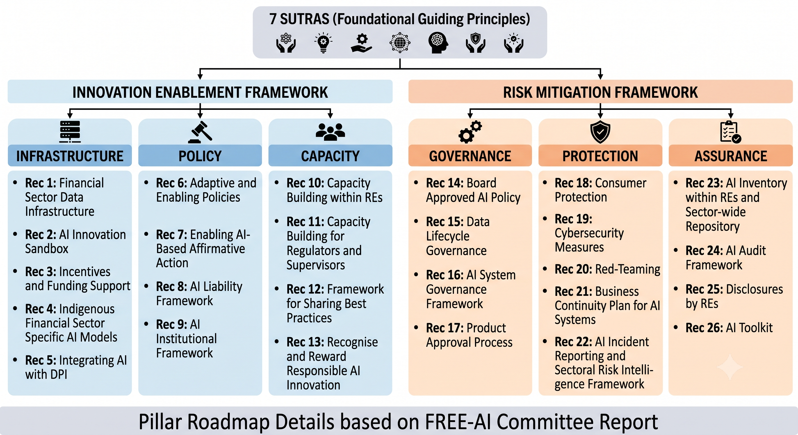

# Help — SentRAI Compliance Console

A governance platform that turns the RBI's **SentRAI Framework** (*Framework for Responsible and Ethical Enablement of AI*) into something you actually run: scan a codebase, find its AI models, register them, close governance gaps, audit them, monitor them for drift, and track incidents — all scoped per project.

> **Working Product Name:** *SentRAI* — the product's job is to verify that an AI system does what it claims and is governed the way it should be.

---

## 1. The Framework This App Implements

The SentRAI Committee Report is anchored in **7 Sutras** (guiding principles), operationalized through **6 Pillars** and **26 Recommendations**. 


This app implements the **Governance**, **Protection**, and **Assurance** pillars end-to-end (Recommendations 14–26) as working software, not just policy text.



### Complete List of Recommendations

#### **Innovation Enablement Framework**

##### *Infrastructure Pillar*
* **Recommendation 1 - Financial Sector Data Infrastructure** *(Page 41)*: Establish a high-quality financial sector data infrastructure as a digital public infrastructure to build trustworthy AI models, integrated with the AI Kosh.
* **Recommendation 2 - AI Innovation Sandbox** *(Page 42)*: Establish an AI innovation sandbox for secure and controlled development of AI-driven solutions by REs, FinTechs, and innovators.
* **Recommendation 3 - Incentives and Funding Support** *(Page 44)*: Put appropriate incentive structures and infrastructure in place for inclusive AI usage among smaller entities, with a fund for data and compute setups.
* **Recommendation 4 - Indigenous Financial Sector Specific AI Models** *(Page 45)*: Develop indigenous AI models (LLMs, SLMs, or non-LLM) tailored specifically for the financial sector as a public good.
* **Recommendation 5 - Integrating AI with DPI** *(Page 45)*: Establish an enabling framework to integrate AI with Digital Public Infrastructure (DPI) to accelerate affordable financial services at scale.

##### *Policy Pillar*
* **Recommendation 6 - Adaptive and Enabling Policies** *(Page 47)*: Periodically assess existing policies, develop a comprehensive AI policy framework anchored in the 7 Sutras, and consider issuing consolidated AI Guidance.
* **Recommendation 7 - Enabling AI-Based Affirmative Action** *(Page 48)*: Encourage AI innovation that accelerates financial inclusion for underserved sections by lowering compliance expectations where possible without losing basic safeguards.
* **Recommendation 8 - AI Liability Framework** *(Page 49)*: Adopt a graded liability framework that encourages innovation, keeping REs liable for customer losses but offering an accommodative supervisory approach for one-off aberrations.
* **Recommendation 9 - AI Institutional Framework** *(Page 50)*: Constitute a permanent multi-stakeholder AI Standing Committee under the RBI and a dedicated financial sector institution operating under a hub-and-spoke model to the national AI Safety Institute.

##### *Capacity Pillar*
* **Recommendation 10 - Capacity Building within REs** *(Page 51)*: Develop AI-related capacity and governance competencies for the Board/C-suite alongside continuous upskilling programs for the broader workforce.
* **Recommendation 11 - Capacity Building for Regulators and Supervisors** *(Page 52)*: Invest in training and institutional capacity building for regulators and supervisors, including a dedicated AI institute to support sector-wide development.
* **Recommendation 12 - Framework for Sharing Best Practices** *(Page 53)*: Establish an industry-driven framework (via IBA or SROs) to exchange AI use cases, lessons learned, and sound governance frameworks.
* **Recommendation 13 - Recognise and Reward Responsible AI Innovation** *(Page 53)*: Introduce structured programs and rewards to recognize responsible AI innovation demonstrating positive social impact and ethical design.

#### **Risk Mitigation Framework**

##### *Governance Pillar*
* **Recommendation 14 - Board-Approved AI Policy** *(Page 55)*: Establish a board-approved AI policy covering governance structure, accountability, risk appetite, operational safeguards, and model lifecycle frameworks.
* **Recommendation 15 - Data Lifecycle Governance** *(Page 56)*: Establish robust internal controls and policies for data collection, usage, retention, and deletion ensuring DPDP Act compliance.
* **Recommendation 16 - AI System Governance Framework** *(Page 57)*: Implement robust model governance across the entire lifecycle and enforce strong governance with mandatory human oversight before deploying autonomous AI systems.
* **Recommendation 17 - Product Approval Process** *(Page 58)*: Bring all AI-enabled products within the scope of the institutional product approval framework, embedding explicit AI-specific risk evaluations.

##### *Protection Pillar*
* **Recommendation 18 - Consumer Protection** *(Page 59)*: Establish a board-approved consumer protection framework prioritized around transparency, fairness, accessible recourse, and customer education campaigns.
* **Recommendation 19 - Cybersecurity Measures** *(Page 59)*: Identify security risks introduced by AI, strengthen the cybersecurity ecosystem, and leverage AI tools for dynamic threat detection and response.
* **Recommendation 20 - Red Teaming** *(Page 60)*: Establish structured red teaming processes spanning the AI lifecycle, with a frequency and intensity proportionate to the assessed risk level.
* **Recommendation 21 - Business Continuity Plan for AI Systems** *(Page 61)*: Augment existing BCP frameworks to include both traditional infrastructure failures and AI-specific model performance degradation or drift.
* **Recommendation 22 - AI Incident Reporting and Sectoral Risk Intelligence Framework** *(Page 62)*: Establish a dedicated incident reporting framework adopting a tolerant, good-faith approach to encourage early, system-wide learning.

##### *Assurance Pillar*
* **Recommendation 23 - AI Inventory within REs and Sector-Wide Repository** *(Page 64)*: Maintain an internal, semi-annually updated AI model inventory within REs, paired with a sector-wide repository established by regulators to track systemic risks.
* **Recommendation 24 - AI Audit Framework** *(Page 65-66)*: Implement a calibrated, risk-based AI audit framework spanning inputs, models, and decision outputs utilizing internal audits, third-party audits for high-risk tools, and biennial framework updates.
* **Recommendation 25 - Disclosures by REs** *(Page 66)*: Mandate standardized public disclosures regarding AI governance frameworks and metrics within annual reports and corporate websites.
* **Recommendation 26 - AI Toolkit** *(Page 67)*: Develop and maintain a standardized, voluntary AI Compliance Toolkit via a recognized SRO or industry body to validate, benchmark, and demonstrate compliance.

| Pillar | What it covers | Where it lives in this app |
|---|---|---|
| **Governance** | Board-approved AI policy, data lifecycle, model governance, product approval | Model Inventory → governance fields, lifecycle stages |
| **Protection** | Consumer protection, cybersecurity, red-teaming, BCP, incident reporting | Drift Monitoring (circuit breakers, BCP), Incidents |
| **Assurance** | AI inventory & repository, audit framework, disclosures, toolkit | Model Inventory, Discover Models, Audit Trail |

> [!NOTE]
> The **Infrastructure**, **Policy**, and **Capacity** pillars (Recs 1–13) are sector-level/regulatory recommendations aimed at regulators and the broader ecosystem — they are referenced in-app (Overview tab) but aren't things a single tool can "implement" for you.

---

## 2. The Workflow

```
1. Create Project        →  Point at an application's source directory
2. Discover Models       →  Static scan finds GenAI/ML/Quant/FinTech signals
3. Triage Candidates     →  Import real models, delete false positives
4. Close Governance Gaps →  Owner, policy ref, oversight, sutras declared
5. Formal Audit          →  Data / model / output dimension checks
6. Deploy + Monitor      →  Drift detection, circuit breakers, BCP fallback
7. Incident Response     →  Report, track SLA, root-cause, remediate
        ↓
   Project Dashboard     →  Compliance %, open gaps, drift status, incidents
                            across all projects — re-scan periodically
```

Steps 4–7 aren't strictly linear — a model can sit in "gaps open" for a while, get audited, and only then move to *Deployed*. The dashboard (Projects tab + Overview tab) is the thing you come back to continuously, not a one-time destination.

---

## 3. Tab-by-Tab Reference

### Projects
Each project tracks one application/codebase independently — its own scan history, its own scoped model inventory. Create a project with a name and a root directory (browsable via the 📁 picker — it lists folders on the server's filesystem, not your browser's). Cards show live model count and compliance ratio. 

*Actions:* **Scan & Discover**, **View Inventory**, **Edit**, **Delete** *(blocked while the project still has tracked models)*.

### Overview
The 7 Sutras explained, plus a live compliance snapshot: total registered models, high-risk count, total incidents, overdue reports, and active circuit breakers.

### Model Inventory
Every registered AI model, project-filterable. Per row:
* **Compliance**: Green *✓ Compliant* or a red *N gap(s) — Close* button that expands an inline panel (directly under the row, no scrolling) where you fill in owner team, board policy reference, oversight posture, declared sutras, and last red-team date. Saving re-checks compliance live.
* **Lifecycle**: *DESIGN* → *DEVELOPMENT* → *VALIDATION* → *DEPLOYED* → *MONITORING* → *DECOMMISSIONED*.
* **View Ledger**: The model's full immutable event history (registration, lifecycle changes, governance updates, grievances), also inline.
* **🗑 (Delete)**: Removes a model from the inventory. Use this for discovery false positives (e.g. a settings page or dashboard component that isn't actually an AI model). Soft-deletes by default — history is kept for audit purposes.

### Discover Models
Points a static, read-only scanner at a directory (or a saved Project). Pattern-matches for:
* LLM/GenAI API calls (`openai.`, `anthropic.`, model name strings)
* ML library usage (`sklearn`, `torch`, `.predict()`, `.fit()`)
* Agent/orchestration patterns (`class FooAgent`, `Swarm`, personas)
* Scoring/decision functions (`riskScore`, `creditDecision`, etc.)

Each candidate gets a **domain tag** (*GenAI / LLM*, *Machine Learning*, *Quant / Trading*, *FinTech / Banking*, *Fraud / Risk*, *Portfolio / Wealth*, *Research / NLP*, *Agent / Orchestration* — a file can carry several), a risk hint, and a static gap report against the 7 Sutras. Check the ones that are real models, uncheck the rest, and click **Import Selected** to register them — gaps and all, ready to be closed in the Inventory tab.

> [!TIP]
> This is heuristic pattern-matching, not a semantic understanding of your code — expect occasional false positives (e.g., a settings page that *mentions* `gpt-4o` in a dropdown will get flagged). That's why **Triage** (step 3 above) exists as its own stage.

### Drift Monitoring
Evaluate a model's live score distribution against its training baseline — computes PSI (Population Stability Index) and Wasserstein distance. Crossing the alert threshold trips a **circuit breaker** and activates **BCP fallback** (rule-based engine takes over until a human reviews). History is kept per model.

### Audit Trail
A deeper, three-dimensional audit than the Inventory tab's gap-closing checklist:
* **Input Data**: Bias checked, consent verified, sources documented, sensitive attributes excluded.
* **Model & Algorithm**: Architecture reviewed, decision logic documented, adversarial robustness tested, performance benchmarks met.
* **Output & Behaviour**: BCP verified, human override tested, explainability score.

Produces a verdict (*Compliant* / *Conditional* / *Non-Compliant*) and schedules the next audit based on risk level (*HIGH* = 6 months, *MEDIUM* = 12 months, *LOW* = 24 months). Also includes a standalone explainability recorder for testing per-decision SHAP/LIME-style output.

### Incidents
Report an AI incident (bias, drift, privacy breach, adversarial attack, unintended autonomous action, etc.) against a model. Severity sets a reporting deadline:
* **P1 Critical**: 6 hours
* **P2 High**: 24 hours
* **P3 Medium**: 72 hours
* **P4 Low**: 7 days

The sectoral risk dashboard aggregates by category/severity and flags overdue reports and active circuit breakers.

---

## 4. Setup Notes

* **Database**: Defaults to PostgreSQL in `config.py`; for local development without Docker, point `DATABASE_URL` in a `.env` file at SQLite instead (`sqlite+aiosqlite:///./dev.db`). Tables are created via SQLAlchemy metadata, not Alembic migrations — schema changes to existing installs need a manual `ALTER TABLE`.
* **Run command**: 
  ```bash
  uvicorn sentrai.main:app --app-dir src --reload --reload-dir src --port 8000
  ```
  > [!IMPORTANT]
  > Use `--reload-dir src` specifically — without it, uvicorn watches the entire project including `.venv`, which can spiral into a reload loop that makes the server unresponsive.
* **API docs**: Full OpenAPI/Swagger UI is served at `/docs`.
* **Directory browsing**: The 📁 Browse buttons read the *server's* filesystem, not your browser's — this only works scanning code the service's host machine can already see.

---

## 5. Where to Go Next

* `/docs` — Interactive Swagger API reference for every endpoint.
* `tests/` — The test suite doubles as executable documentation for exact request/response shapes (76 tests across inventory, discovery, projects, monitoring, audit, incidents).

---

## 6. Future Development

To elevate **SentRAI** into a premium, high-demand enterprise-grade AI governance platform, the following features are planned for future development:

### 🚀 Automated Red-Teaming & Security Scanning
Instead of simply tracking manual red-teaming dates, integrate automated active-probing tools. This will run routine simulated attacks (e.g., prompt injections, adversarial noise, and data leakage scans) on registered models and score their vulnerabilities automatically.

### 🔔 Real-Time Drift Webhooks & Alerting
Introduce background monitoring workers that periodically pull live scoring tables and evaluate drift. If a metric crosses the threshold or a circuit breaker trips, SentRAI will dispatch instant alerts to communication tools like **Slack**, **Microsoft Teams**, or emergency notification channels like **PagerDuty**.

### 📁 Automated Evidence Collection
Reduce compliance paperwork by linking codebases directly to evidence generators. SentRAI will automatically scan Git commits, database schemas, and ML training pipelines to generate immutable compliance proof records without human overhead.

### ⚖️ Active Bias Mitigation & Fair-AI Toolkits
Provide plug-and-play middleware that mitigates bias on the fly. If the audit trail identifies a demographic parity gap in an underwriting model, SentRAI will recommend or run active re-weighting algorithms to balance model outputs.

### 📄 One-Click Regulatory Filings
Export pre-compiled compliance portfolios formatted as certified PDFs. These reports will match regulatory requirements exactly (e.g., RBI Annexures, EU AI Act conformity declarations) for direct submission to governing bodies.

