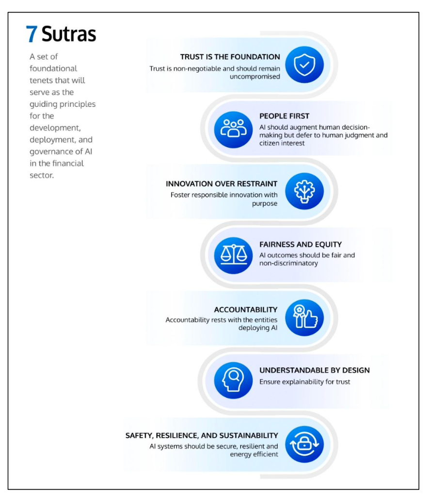

# SentRAI Compliance Console — User Guide

**SentRAI** is a self-hosted AI-governance console for financial services. It turns four regulatory frameworks into software you actually run: it discovers the AI models in your codebase, scores them against **RBI FREE-AI** (*Framework for Responsible and Ethical Enablement of AI*), the **NIST AI RMF**, the **EU AI Act**, and **ISO/IEC 42001**, monitors deployed models for drift, keeps a defensible audit trail, and blocks ungoverned AI from shipping through a CI/CD gate.

This guide explains **every menu item** in detail. Skip to any tab below, or read the short orientation first.

---

## How SentRAI is organized

```
Organization (tenant)
  └── Project           one application's codebase (own scan history + model inventory)
        └── AI Models   the ML / LLM / rules models found in that codebase
              └── Governance   compliance, drift, audits, incidents, CI gate
```

- An **Organization** fully isolates its projects, models, users, and gate history from every other organization.
- A **Project** is one application you want to govern. You create one project per app.
- Most tabs work on the **Active Project** — the project you've selected. Pick one on the **Projects** tab first; the project-scoped tabs then unlock.

---

## The top bar (always visible)

| Element | What it does |
|---|---|
| **SentRAI — Console** | Home / product title. |
| **☀️ Light Mode / 🌙 Dark Mode** | Toggle the colour theme. |
| **● service healthy** | Live backend health indicator. |
| **User chip** | Your name and role (VIEWER, OWNER, REVIEWER, APPROVER, CISO, or ADMIN). |
| **Sign out** | End your session. |
| **Active Project · «name» · × Close Project** | Appears once you activate a project. Shows which project the scoped tabs are working on; **Close Project** returns you to the project list. |

---

## Menu reference

The navigation tabs, in order. Some are visible only for certain roles or once a project is active — that's noted per item.

### 1. Projects
*Visible to: everyone.*

A project tracks **one application's codebase** — its own scan history and its own scoped model inventory. Create one project per app you govern.

**Create a project** with **+ New Project**:
- **Name** and optional **Description**.
- **Codebase source** (pick one):
  - **Upload .zip** — a zip of your source. *Exclude `node_modules` and build folders* before zipping; a very large archive can be rejected by the host's request-size limit.
  - **Upload folder** — select your application's folder; source files upload directly (`node_modules`/`.git` skipped). Best for large or dependency-heavy projects.
  - **GitHub repo** — `owner`, `repository`, `branch` (default `main`), and an optional access token for private repos (used once to download, never stored).

On creation the codebase is uploaded and **scanned automatically**; the card then shows how many AI files were discovered.

**Project card actions:** **⚡ Select & Activate Project** (makes it the Active Project and unlocks the scoped tabs), **✏️ Edit**, **🗑 Delete**.

> **Tip:** You must activate a project to use Overview, Model Inventory, Drift Monitoring, Audit Trail, Incidents, and Lineage Graph.

### 2. Overview
*Visible to: everyone, once a project is active.*

An at-a-glance governance snapshot for the active project: the **Seven Sutras of Responsible AI** (the foundational principles) and a **Compliance Snapshot** — registered models, high-risk count, open gaps, incidents, and active circuit breakers.

### 3. Compliance Rollup
*Visible to: everyone, always.*

The **executive, portfolio-wide** readiness view — the board-level answer. It aggregates across every project you can see, and narrows to the active project if one is selected.

- **Headline banner** — e.g. *"2 of 5 models (40%) fully compliant across all four frameworks; 1 high-risk, 12 blocking control gaps open."*
- **Stat boxes** — Models, Fully Compliant, High-Risk, Open Blocking Gaps.
- **Shift-Left Pre-Deployment Gate** — live signal from the CI ledger: Gate Readiness %, Active Blocked Gates, Shadow AI Assets, Gate Events.
- **Framework Readiness** cards — RBI FREE-AI (7 Sutras), NIST AI RMF, EU AI Act, ISO/IEC 42001 — each with a pass rate and a plain-English readiness line.
- **Most Common Blocking Gaps** — the top control gaps across the portfolio, in plain language (e.g. *"2 models lack a named accountability owner"*).
- **⬇ Readiness PDF** — a concise one-page portfolio-readiness snapshot (framework readiness, risk tiers, top gaps).
- **⬇ Board Report** — the full board pack: cover, executive summary with the AI-drafted narrative, regulatory framework readiness, **Controls In Force** (shift-left CI gate, runtime tool-authorization enforcement, and audit-ledger integrity), **Incidents & Consumer Redress**, and priority remediation. Every figure is assembled live from the rollup plus the incident, grievance, gate, runtime-telemetry and hash-chained-audit records — a single document a risk committee reads in one sitting.

### 4. CI Gate Ledger
*Visible to: ADMIN, CISO, REVIEWER, APPROVER.*

The immutable, append-only record of **every CI/CD pre-deployment gate decision** — the defensible trail of what your pipeline let through or blocked before it reached production.

**Table columns:** Commit (short hash + PR number), Project, When (relative time), **Verdict** (`PASS` / `FAIL` / `OVERRIDDEN`), Models detected, and **Triage — core reasons** (the governance gaps, with a `SHADOW` badge for ungoverned assets).

**Controls:** verdict filter (All / Failed / Passed) and **↻ Refresh**.

**Audit →** opens the detail modal:
- **Blocking Violations & Flagged Code** — each violation shows the flagged file, the missing controls, and an inline **code viewer** highlighting the exact AST-flagged lines (for example a disguised `from transformers import Pipeline as rogue_ai`). **Tool-authorization violations are line-accurate**: an agent that calls an unauthorized tool (say `initiate_refund` / a payments capability) shows the exact line the tool is invoked on, and that line drives the SARIF annotation too.
- **View SARIF / Download .sarif** — reproduce the exact SARIF report the pipeline uploaded to the GitHub/GitLab Security tab, rebuilt from the recorded gate event: rule id, `error` level, message, and the offending file + line. Read it inline or download it — the auditor never has to leave the console to see what the pipeline saw.
- **Grant Auditing Sign-Off Override** *(ADMIN / CISO / APPROVER only)* — record a justification to sign off a failed gate. This is **additive**: the original `FAIL` is preserved on the immutable record; the gate then shows as `OVERRIDDEN` with your identity, timestamp, and reason.

This ledger is fed by the CI integration — see **CI/CD integration** below.

### 5. Model Inventory
*Visible to: everyone, once a project is active.*

The register of AI/ML/LLM models in the active project — the "AI inventory" regulators expect you to maintain.

**Asset-kind filter.** The header chips — **All · LLM · ML · Agents · MCP** — narrow the compliance matrix (and the KPI band, gaps queue and calendar with it) to one kind of asset, so in a mixed estate you can look at just the tool-calling agents or just the MCP servers.

**Discovery review — detection evidence.** When a scan finds AI components, the review modal lists each candidate; expanding a row shows the **detection evidence** behind it — every static/AST signal with its line number and the matched code (e.g. `L8  LLM_API_CALL  openai.chat.completions.create(`), plus any embedded prompts or hardcoded secrets. This is the "how do you know it's an LLM?" answer, in source.

**+ Register Model** captures: Model Name; **Model Type** (Machine Learning, Deep Learning, NLP, Generative AI, Rules-Based, Hybrid); Functional Area (e.g. `credit_underwriting`, `fraud_detection`); Owner Team; Use Case Description; Developed By; Board Policy Reference; Target Customer Segments; Human Oversight Required; Autonomous Scope; and **Sutras Declared** (the seven principle checkboxes).

Each model shows its type, **risk level**, **lifecycle stage**, and a **compliance check** across the frameworks. Close gaps by editing the model's governance fields; lifecycle promotion is **gated on governance completeness** (a model can't advance until its required controls are satisfied). The *Close Governance Gaps* drawer also shows the model's **board-approval status inline** — the latest review-board decision, its target stage, who requested it and who decided it — so the sign-off lives with the model, not only on the Alignment page.

**🔄 Re-scan Models** re-evaluates every model against the current SentRAI logic and re-reads the codebase for models linked to a source file — updating risk levels where they changed. **Your governance edits (owner, policy, sutras, lifecycle) are preserved.**

**Tool authorization (Control).** For agents and tools, the scan extracts the **tools and capabilities the code actually invokes** — named tools (`@tool`, `server.tool("…")`) and capability primitives (shell exec, network egress, filesystem writes, database, cloud, email, payments). In *Close Governance Gaps → Tool Authorization*, check the tools the model is **permitted** to use; any *detected* tool left unchecked is an authorization violation. The **CI gate blocks a build when an agent calls a tool outside its permitted set** — declare an agent's tool boundary once, and the pipeline enforces it.

**Operational kill switch (Control).** ADMIN/CISO can **Suspend** a model from *Close Governance Gaps → Operational Control* — a deliberate stop, separate from the drift-driven fallback. A deployed agent polls `GET /api/v1/control/models/:id/poll` each loop and halts when it sees the kill switch, so a misbehaving system can be stopped in seconds without a redeploy. Every suspend/resume is on the model ledger and pushed to the governance webhook.

**Adversarial evidence & secret hygiene (Security).** In *Close Governance Gaps → Adversarial / red-team evidence*, ingest a garak / PyRIT / promptfoo run (probes and breaches); it stores a typed `red_team` artifact **and** stamps the model's last-red-team date, satisfying that control in one step. Separately, one unified secret-pattern library backs both the codebase scanner's hardcoded-secret findings and the redactor that masks credentials before any snippet reaches an LLM — AWS/GitHub/Google/Slack/Stripe/provider keys, JWTs and PEM private keys included.

### 6. Drift Monitoring
*Visible to: everyone, once a project is active.*

Watch deployed models for drift and keep a safety fallback.

- **Evaluate Model Drift** — pick a model and run drift detection; computes **PSI (Population Stability Index)** and **1-D Wasserstein distance** against the baseline.
- **Circuit breaker** — trips automatically when **PSI > 0.20** or accuracy drops **> 5 percentage points**, signalling the model should fall back.
- **BCP Fallback Status** — the business-continuity posture; a rule-based fallback takes over when the breaker trips, until a human reviews.
- **Drift History** — past evaluations per model.

### 7. Audit Trail
*Visible to: everyone, once a project is active.*

Formal, three-dimensional audits plus the platform's activity log.

- **Initiate Audit** — a risk-based audit across **Input Data**, **Model & Algorithm**, and **Output & Behaviour** → a verdict (*Compliant* / *Conditional* / *Non-Compliant*) and a scheduled next-audit date by risk tier (HIGH = 6 months, MEDIUM = 12 months, LOW = 24 months).
- **Audit History** — past audits per model.
- **Test Decision Explainability** — record and review per-decision explainability evidence (SHAP/LIME-style), for the "understandable by design" requirement.

Separately, **every mutating action** in the platform is written to an immutable, PII-masked audit-event log — and that log is **tamper-evident**: each event records a SHA-256 over its own content plus the previous event's hash, chain-linked from a genesis marker. The activity log shows each event's **Hash** column; expanding an event reveals its full `sha256` and `prev_hash`. **Verify chain** walks the whole chain end to end, recomputing every hash — an edited, deleted, or re-ordered record breaks every link after it, and the verdict names where. "Append-only" stops being a promise you take on trust and becomes a property you can check.

### 8. Incidents
*Visible to: everyone, once a project is active.*

Report and track AI incidents, with sectoral risk intelligence.

- **Report AI Incident** — choose a model, an incident type (Bias / Discrimination, Model Drift, Data Privacy Breach, Explainability Failure, Adversarial Attack, Unintended Autonomous Action), and a severity. Severity sets a reporting deadline: **P1 Critical 6h**, **P2 High 24h**, **P3 Medium 72h**, **P4 Low 7d**.
- The **sectoral risk** dashboard aggregates by category and severity, and flags overdue reports and active circuit breakers.
- Reporting an incident and resolving it are both written to the affected model's **immutable ledger** (`INCIDENT_REPORTED` / `INCIDENT_RESOLVED`), so an incident and its resolution appear in the model's **cross-ledger timeline** alongside its approval, CI gates, deployment and runtime — the full lifecycle in one column.

### 9. Lineage Graph
*Visible to: everyone, once a project is active.*

An interactive dependency graph (built with Cytoscape) of your models and their relationships — trace how models connect and where a change ripples through the system.

### 10. Docs
*Visible to: everyone.*

This guide.

### 11. Users
*Visible to: ADMIN and OWNER.*

Manage the people in your organization.

- **+ Add User** — Full Name, Email, Password, Role. (A global **ADMIN** also picks an Organization; an **OWNER's** new users go into the OWNER's own organization automatically.)
- Per user: change **Role** (inline dropdown), **Reset Password**, **Deactivate / Activate**, **Delete**.
- **Scope & guardrails:** an OWNER sees and manages only their own organization's users and can grant any role **up to CISO** (never ADMIN); a global ADMIN manages everyone. You cannot change your own role, deactivate yourself, or remove the last active admin/owner of an organization.

### 12. Organizations
*Visible to: a global ADMIN (an ADMIN with no organization of their own).*

Manage organizations (tenants). Each organization fully isolates its projects, models, gate ledger, and users from every other. **New Organization** captures a Name and Description.

### 13. AI Settings
*Visible to: ADMIN, CISO, OWNER — because choosing where model code snippets are sent is a governance decision.*

Configure the AI model your organization uses for drafting (✨ Summarize, ✨ Draft rationale, ✨ Draft remediation plan) — bring your own LLM:

- **AI Providers** — pick a preset (OpenAI, Google Gemini, Anthropic Claude, **Ollama for fully local**, OpenRouter, Together.ai, Hugging Face, Groq, Mistral, or any OpenAI-compatible endpoint), enter the base URL, model name, and API key. Keys are encrypted at rest and **never displayed again** — only a mask like `sk-…x4Q2`. Every card shows a **data-egress badge**: 🔒 *Local* means nothing leaves your network; 🌐 *External* means secret-masked snippets are sent to that provider. **⚡ Test** fires a one-token live call so a bad key fails at setup, not first use. Each configured provider is **self-registered in your Model Inventory** (project "AI Governance Tooling") — the LLM you use for governance is itself a governed AI system, with gaps to close like any other.
- **Usage strip** — total AI calls, ok/failed, token in/out counts, and average latency for your organization: cost and reliability at a glance. Every call is also recorded in the audit trail with who invoked it and for what.
- **Prompt Vault** — the exact instructions sent to the AI for each task. Editable per organization; every save is a **new version** (nothing is overwritten), with history, restore, and reset-to-default. Templates use `{{variables}}` filled from the model being processed; removing a required variable is blocked at save.
- **Without any provider configured**, all AI buttons still work using a built-in rule-based engine — fully local, deterministic, and labeled "⚙ Auto-draft" so reviewers know its origin.

All AI output is a **draft with provenance** (✨ AI-drafted / ⚙ Auto-draft / ✓ human-confirmed): a human reviews and saves before it becomes part of the governance record.

### 14. LLM Usage
*Visible to: ADMIN, CISO, OWNER — the people accountable for AI spend and reliability.*

What your organization is actually spending on LLM calls, and how reliably they succeed. Pick a window (7 / 30 / 90 days).

- **Headline figures** — total calls, success rate, tokens in/out, average and p95 latency. A success rate below 90% turns red.
- **Daily volume** — one bar per day, with failures stacked in red above successes, so a bad day is obvious at a glance.
- **Breakdowns** — by use case (summary, risk rationale, gap remediation, executive narrative), by model, by provider, and by actor, each with call counts, token totals and average latency. This is what answers "who is driving the spend".
- **Recent failures and recent calls** — the individual events behind the numbers, including who invoked them.

Only calls that actually reach a configured provider are counted. Generations that fall back to the built-in rule-based engine cost no tokens and are deliberately **not** recorded as LLM usage — so an empty dashboard with a busy inventory means no provider is configured, not that nothing happened.

Scans generate summaries, risk rationales and remediation plans automatically, so this is also where the cost of that automation shows up.

### 15. Alignment
*Board sign-off and periodic re-certification — the workflows that keep every AI system doing what the institution sanctioned.*

Two governance workflows, switchable with the **Approvals / Attestations** toggle at the top.

- **Review-board approvals** — a **MEDIUM/HIGH-risk model cannot be promoted to a live stage (DEPLOYED / MONITORING) until it has a recorded board sign-off**. An owner clicks **Request** (choosing the target stage and how many approvals are needed), then one or more independent approvers (APPROVER / CISO / ADMIN) **Approve** or **Reject**. The **requester can never decide their own request** (separation of duties), and no approver votes twice. Once the approval quorum is met, a **Promote** button takes the model live. Every request, vote, and promotion is written to the model ledger. LOW-risk models keep the lighter self-service path.
- **Attestation campaigns** — periodic re-certification of the active inventory. Open a campaign (title, cadence in days, optional risk-tier scope) and it **snapshots every in-scope active model into a checklist**. Owners **Attest** (still within sanctioned scope) or **Flag** (needs review) each one; a flag escalates immediately. Items left pending past the due date are escalated automatically by the daily job. Progress and flagged counts show on each campaign.
- **Behavioral eval evidence** — on a model's *Close Governance Gaps* screen, the **Behavioral eval evidence** box ingests eval-harness output (promptfoo / garak / PyRIT: suite name + passed/total) as a typed `behavioral_eval` evidence artifact with its parsed pass-rate, so a reviewer sees test *results*, not just a link.

*Visible to: everyone can view; deciding approvals is limited to APPROVER / CISO / ADMIN, and opening campaigns to OWNER / APPROVER / CISO / ADMIN.*

### 16. Runtime Visibility
*What your AI systems are actually doing once deployed — action telemetry and a cross-ledger timeline.*

Governance so far covers *code* (the CI gate) and *state* (the model ledger). Runtime Visibility covers *behaviour* — the actions deployed agents take.

- **Agent identity propagation** — each CI scan returns a `SENTRAI_MODEL_ID` for every governed asset it detects. Stamp that into the deployed build (an env var); the agent then tags the telemetry it emits with it, so runtime events join back to the exact registry entry. The id is shown at the top of each model's timeline.
- **Action telemetry** — deployed agents `POST /api/v1/telemetry/events` with typed events (`tool_call`, `decision`, `handoff`, `output`, `error`) tagged with their model id. The KPI band shows total events, active sessions, and models reporting. A **`tool_call` whose tool is outside the model's permitted set is flagged the moment it arrives** — static tool authorization (§5), observed at runtime.
- **Cross-ledger timeline** — pick a model to see one time-sorted view that stitches together its governance-ledger events, CI gate decisions, incidents, drift reports, and runtime actions. This is the single pane an investigator needs when something goes wrong.
- **Scope-deviation alerts** — when a model accumulates flagged runtime tool calls (tools outside its permitted set), it surfaces as a **scope deviation** in the red strip at the top, graded by severity (HIGH for high-risk or autonomous models). A daily job also escalates these to the governance webhook and writes an alert onto the model ledger.
- **Emit sample (demo)** — with no deployed agent wired up, ADMIN/CISO/OWNER can inject a few sample events (including one unauthorized tool call) to see the flow end to end.

### 17. Consumer Grievances
*The redress mechanism — a tracked, SLA-bound path for the people an AI system affects.*

Where the model inventory only tallied a grievance count, this is a first-class workflow.

- **File** — staff log a consumer complaint against a model with a category and severity. Severity sets the **SLA deadline** (HIGH 7 days, MEDIUM 15, LOW 30). The SLA clock starts immediately.
- **State machine** — a grievance moves `RECEIVED → ACKNOWLEDGED → INVESTIGATING → RESOLVED` (or `REJECTED`) `→ CLOSED`; illegal jumps are refused. The KPI band shows total, open, **SLA-overdue**, and resolved; overdue rows are highlighted, and a daily job escalates breaches to the governance webhook. Every transition is written to the model ledger, so redress shows up in the cross-ledger timeline.
- **Public redress** — every model has a **public transparency card** (the "↗ Public transparency card" link on its *Close Governance Gaps* screen, at `/card/<id>`): a consumer-facing page describing what the system does, its risk tier, whether a human is in the loop, which regulatory frameworks govern it, and a **File a grievance** button that submits with no account required. The frameworks and their disclosure timelines are driven by a declarative regime registry (`/api/v1/regimes`) — adding a jurisdiction is a config entry, not a code change.

---

## Roles & permissions

| Role | Typical use | Scope of authority |
|---|---|---|
| **VIEWER** | Read-only stakeholder | View the dashboards and data they're scoped to. |
| **OWNER** | Organization / model owner | Administer their own org's **users** (up to CISO), projects, and models. |
| **REVIEWER** | Auditor | Review the CI Gate Ledger and audits. |
| **APPROVER** | Sign-off authority | As reviewer, **plus** grant gate sign-off overrides. |
| **CISO** | Compliance leadership | Broad governance authority within the organization. |
| **ADMIN** | Global superuser | Everything, across **all** organizations. |

Organization isolation is enforced everywhere: a non-admin user only ever sees and acts on their own organization's data.

---

## Installation & configuration (self-hosting)

SentRAI is a single NestJS application that serves the API and both consoles from one process — one server, one database, no separate frontend deployment.

### Requirements

- **Node.js 18+** (20 LTS recommended) and npm.
- **MariaDB / MySQL** for production (SQLite is used automatically in development — zero setup).
- Optional: **Neo4j** for the Lineage Graph (everything else works without it).

### Quick start (development)

```bash
git clone https://github.com/sujitdhanuka/SentRAI-Console.git
cd SentRAI-Console
npm install
npm run start:dev        # SQLite dev.db, schema auto-created, admin auto-seeded
```

Open `http://localhost:3000`, sign in with the seeded admin (`admin@sentrai.local` / the password printed to the console on first boot), and you're in.

### Production configuration (environment variables)

Set these in your host's environment (control panel → environment variables, a `.env` file, or your process manager):

| Variable | Required | What it does |
|---|---|---|
| `NODE_ENV` | yes | Set to `production`. Hardens boot checks, disables Swagger. |
| `PORT` | no | HTTP port (default 3000). |
| `PUBLIC_URL` | yes | Canonical external URL (e.g. `https://sentraiconsole.com`) — used in links, cards, and the sitemap. |
| `DB_PROVIDER` | yes | `mariadb` in production. |
| `DB_HOST` / `DB_PORT` / `DB_USER` / `DB_PASSWORD` / `DB_NAME` | yes | Your MariaDB connection. |
| `DB_SYNCHRONIZE` | yes | **`false` in production.** The built-in schema-guard applies safe, additive schema updates on boot instead — no manual migrations to run. |
| `REQUIRE_PERSISTENT_DB` | recommended | `true` — refuses to boot on an ephemeral database so a misconfiguration can't silently lose data. |
| `JWT_SECRET` | yes | Long random string (32+ chars). **The app refuses to boot in production with a weak or default secret.** |
| `APP_ENCRYPTION_KEY` | yes | 32-byte key for AES-256-GCM encryption of stored AI-provider API keys. Generate once (`openssl rand -hex 32`) and never rotate casually — existing encrypted keys need it. |
| `SEED_ADMIN_EMAIL` / `SEED_ADMIN_PASSWORD` | first boot | Bootstrap admin. In production the password must be 12+ chars. `SEED_ADMIN_RESET=true` is the break-glass recovery path (forces the admin password back, then set it to `false` again). |
| `CORS_ORIGINS` | no | Comma-separated allowed origins if a separate frontend origin calls the API. |
| `WEBHOOK_URL` | no | Receives governance notifications (gate failures, drift alerts, kill-switch events). |
| `NEO4J_URI` / `NEO4J_USER` / `NEO4J_PASSWORD` | no | Enables the Lineage Graph; the app degrades gracefully without it. |
| `EXPOSE_DOCS` | no | `true` to expose the Swagger API explorer in production (off by default). |
| `AI_SUMMARIZER_PROVIDER` / `AI_SUMMARIZER_BASE_URL` / `AI_SUMMARIZER_MODEL` | no | Platform-default LLM for AI drafting (orgs can override per-tenant in **AI Settings**; point at Ollama for zero-egress). |

### Build & run

```bash
npm ci
npm run build            # compiles the API to dist/
npm run start:prod       # node dist/main
```

The React console is pre-built and served by the same process — no separate frontend step. On boot the **schema-guard** creates any missing tables/columns (additive only, never destructive), the admin is seeded if absent, and `/health` goes green.

### Auto-update from GitHub (git-based deployment)

To have your server update itself on every release — the way the hosted instance works:

1. **Connect the repository** in your host's Git deployment panel (Hostinger: *Websites → your site → Git*; most panels are equivalent): repository `https://github.com/<you>/SentRAI-Console.git`, branch **`main`**.
2. **Set the build command** to `npm run deploy:build` (equivalent to `npm ci && npm run build && npm prune --omit=dev` — the prune strips dev-only packages after building, so the server disk carries runtime dependencies only and vulnerability scanners don't flag build tooling). Set the start command to `npm run start:prod` (or restart your process manager).
3. **Enable the webhook / auto-deploy toggle.** The panel registers a GitHub webhook; from then on **every push to `main` pulls, rebuilds, and restarts automatically** — typically live in 2–3 minutes.
4. **Verify a deploy landed:** `curl https://your-host/health` — the response carries `build` (the running version tag), `db: ok`, and `uptime_s` (near zero right after a restart). If `build` shows the new version, the update is live.

> ⚠️ With auto-deploy, **a push to `main` *is* a production release**. Do day-to-day work on a `dev` branch and fast-forward `main` only after tests pass — and take a database backup before schema-affecting releases (`scripts/backup.sh`).

### First-login hardening checklist

1. Sign in as the seeded admin → change the password immediately.
2. Create your organization and real users with least-privilege roles (see *Roles & permissions* above); keep ADMIN accounts to a minimum.
3. Confirm `/health` shows `db: ok` and the expected `build`.
4. Schedule `scripts/backup.sh` (cron) and test `scripts/restore.sh` once — before you need it.

---

## CI/CD integration (the shift-left gate)

Stop ungoverned AI *before* it ships:

1. An **ADMIN/CISO mints a CI service token** (`POST /api/v1/ci/tokens`) and stores it as a pipeline secret named `SENTRAI_CI_TOKEN`.
2. Add the SentRAI gate to your pipeline — a ready-made **GitHub Action** and **GitLab** template live under `ci-integration/`. On each push or PR it sends the changed source to `POST /api/v1/ci/scan`.
3. SentRAI scans for AI usage, evaluates it against your **`.sentrai/policy.yaml`** (policy-as-code; it falls back to safe defaults if the file is absent), and returns a **pass/fail verdict plus SARIF** (rendered natively in GitHub/GitLab security tabs). A failing gate exits non-zero and blocks the deploy.
4. Every decision is recorded in the **CI Gate Ledger**, where an auditor can review the flagged code and, if justified, sign off an override.

### Step-by-step: wiring a GitHub repository

**A. Mint the CI token (in the app).** CI Gate Ledger → **"⚙ Set up CI scanning"** (ADMIN/CISO). Pick the project to gate; the app generates a project-scoped token and a ready-to-paste snippet. The token can *only* drive the pipeline gate — it cannot log into the console.

**B. Add the credentials to GitHub.** In the repository: *Settings → Secrets and variables → Actions*:
- **Secret** `SENTRAI_CI_TOKEN` — the token from step A.
- **Variable** `SENTRAI_URL` — your SentRAI base URL (e.g. `https://sentraiconsole.com`).

**C. Add the workflow.** Copy `ci-integration/github-workflow.yml` into the repo as `.github/workflows/sentrai-gate.yml`. It runs on every PR and push to `main`, references the packaged action (nothing to vendor), and uploads SARIF:

```yaml
- name: SentRAI Pre-Deployment Gate
  uses: sujitdhanuka/SentRAI-Console/ci-integration/sentrai-gate-action@v1
  with:
    sentrai-url: ${{ vars.SENTRAI_URL }}
    ci-token: ${{ secrets.SENTRAI_CI_TOKEN }}
```

**D. Add your policy.** Copy `ci-integration/policy.example.yaml` to **`.sentrai/policy.yaml`** in the gated repo and tune the gates (risk ceilings, secret rules, tool authorization). No file = safe fail-closed defaults.

**E. Make the gate blocking.** *Settings → Branches → Branch protection rule* for `main` → **"Require status checks to pass"** → select **"SentRAI AI Compliance Gate"**. From now on a PR that introduces ungoverned AI, a leaked secret, or an agent using an unauthorized tool **cannot be merged** until it's fixed or an APPROVER signs an override in the CI Gate Ledger.

**F. See findings where developers live.** Violations render in the PR's **Security tab** via SARIF (the workflow's `security-events: write` permission handles the upload; private repos need GitHub Code Scanning enabled).

**GitLab:** the same gate script (`ci-integration/sentrai-gate.mjs`) runs as a `node` job — see `ci-integration/README.md` for the `.gitlab-ci.yml` block.

### Keeping the inventory in sync automatically

`ci-integration/sync-models.mjs` pushes model records from *your* application's database into the SentRAI inventory via the API. It's idempotent (already-registered models are skipped), so it's safe to run on a schedule — a nightly cron or CI job keeps the governed inventory mirroring reality without manual entry. See the header of the script for the environment variables it needs.

---

## Tips & troubleshooting

- **Large or dependency-heavy repos:** use **Upload folder** or **GitHub repo** rather than a `.zip` — a big archive can exceed the host's upload limit.
- **"Not scanned" on a project card:** upload a codebase (zip/folder/GitHub); scanning runs automatically on upload and the result is stored.
- **Can't see a tab:** Overview, Model Inventory, Drift Monitoring, Audit Trail, Incidents, and Lineage Graph need an **active project**; the CI Gate Ledger, Users, and Organizations tabs are **role-gated** (see above).
- **Data & deployments:** hosted deployments run on a persistent MariaDB, so your data survives application updates. (The interactive Swagger API explorer is intentionally disabled in production.)

---

## Appendix — the frameworks behind SentRAI

SentRAI operationalizes India's **RBI FREE-AI** framework alongside three global standards, mapping a single assessment to all four.

The RBI FREE-AI report is anchored in **7 Sutras** (guiding principles), operationalized through **6 Pillars** and **26 Recommendations**.



This app implements the **Governance**, **Protection**, and **Assurance** pillars end-to-end (Recommendations 14–26) as working software — not just policy text.


| Pillar | What it covers | Where it lives in this app |
|---|---|---|
| **Governance** | Board-approved AI policy, data lifecycle, model governance, product approval | Model Inventory (governance fields, lifecycle stages) |
| **Protection** | Consumer protection, cybersecurity, red-teaming, BCP, incident reporting | Drift Monitoring (circuit breakers, BCP), Incidents |
| **Assurance** | AI inventory & repository, audit framework, disclosures | Model Inventory, Projects (codebase scan), Audit Trail |

> The **Infrastructure**, **Policy**, and **Capacity** pillars (Recommendations 1–13) are sector-level recommendations aimed at regulators and the broader ecosystem — referenced for context, but not something a single tool implements for you.

### The 26 RBI FREE-AI Recommendations

**Innovation Enablement — Infrastructure Pillar**
1. **Financial Sector Data Infrastructure** — a high-quality financial-sector data infrastructure as digital public infrastructure, integrated with the AI Kosh.
2. **AI Innovation Sandbox** — a secure, controlled environment for AI development by REs, FinTechs, and innovators.
3. **Incentives and Funding Support** — incentive structures and infrastructure for inclusive AI usage among smaller entities.
4. **Indigenous Financial-Sector AI Models** — indigenous models (LLMs/SLMs or non-LLM) tailored to the financial sector as a public good.
5. **Integrating AI with DPI** — a framework to integrate AI with Digital Public Infrastructure for affordable services at scale.

**Innovation Enablement — Policy Pillar**
6. **Adaptive and Enabling Policies** — a comprehensive AI policy framework anchored in the 7 Sutras.
7. **Enabling AI-Based Affirmative Action** — AI innovation that accelerates financial inclusion for underserved sections.
8. **AI Liability Framework** — a graded liability framework that keeps REs liable but accommodates one-off aberrations.
9. **AI Institutional Framework** — a permanent multi-stakeholder AI Standing Committee under the RBI.

**Innovation Enablement — Capacity Pillar**
10. **Capacity Building within REs** — AI governance competencies for the Board/C-suite and workforce upskilling.
11. **Capacity Building for Regulators and Supervisors** — training and institutional capacity for supervisors.
12. **Framework for Sharing Best Practices** — an industry-driven exchange of use cases and governance practices.
13. **Recognise and Reward Responsible AI Innovation** — programs that reward responsible, high-impact AI.

**Risk Mitigation — Governance Pillar**
14. **Board-Approved AI Policy** — governance structure, accountability, risk appetite, safeguards, and model-lifecycle framework.
15. **Data Lifecycle Governance** — controls for data collection, usage, retention, and deletion (DPDP Act compliant).
16. **AI System Governance Framework** — lifecycle governance with mandatory human oversight before autonomous deployment.
17. **Product Approval Process** — AI-enabled products within the product-approval framework, with AI-specific risk evaluations.

**Risk Mitigation — Protection Pillar**
18. **Consumer Protection** — transparency, fairness, accessible recourse, and customer education.
19. **Cybersecurity Measures** — identify AI-introduced risks and use AI for dynamic threat detection.
20. **Red Teaming** — structured red-teaming across the lifecycle, proportionate to risk.
21. **Business Continuity Plan for AI Systems** — BCP covering AI-specific performance degradation and drift.
22. **AI Incident Reporting & Sectoral Risk Intelligence** — a good-faith incident-reporting framework for system-wide learning.

**Risk Mitigation — Assurance Pillar**
23. **AI Inventory & Sector-Wide Repository** — a semi-annually updated internal AI model inventory.
24. **AI Audit Framework** — a calibrated, risk-based audit spanning inputs, models, and outputs.
25. **Disclosures by REs** — standardized public disclosures on AI governance and metrics.
26. **AI Toolkit** — a standardized toolkit to validate, benchmark, and demonstrate compliance.
